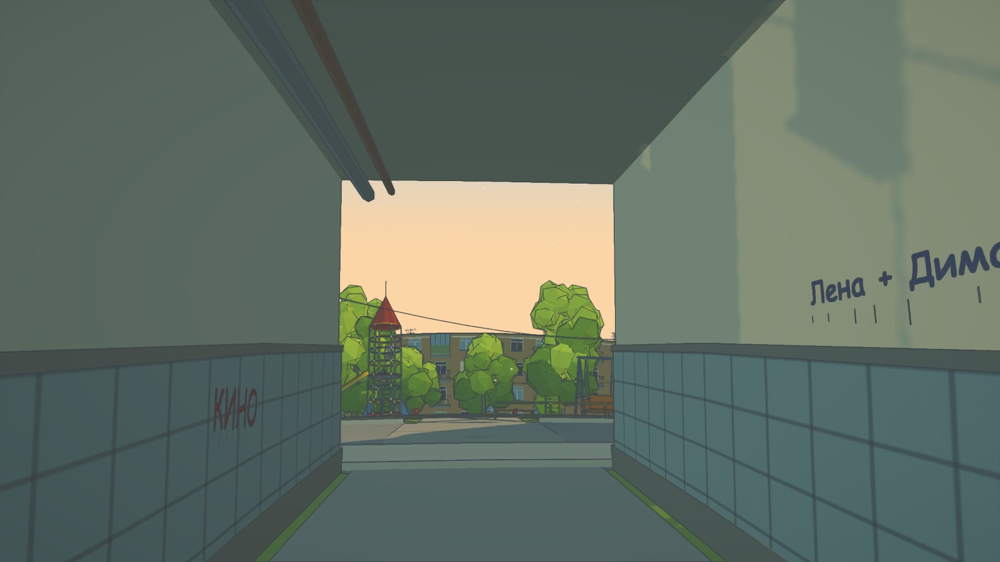

# Dvor — The Yard

An explorable memory of a post-Soviet courtyard, June 2001. A fictional place drawn from the feeling of childhood: warm asphalt, poplar fluff, an empty playground, a carpet on the beating frame, and a tram beyond the apartment blocks.

**[Walk through the yard](https://dvor-english.vercel.app/)**



The world is real 3D geometry in Three.js, rendered to evoke a hand-painted animation background. The writing on walls, garages, notices, pavement and the tram stays in Russian. Look closely and press **E** for an English translation and a short cultural note. The original lettering remains part of the place rather than being replaced by English textures.

## Run locally

Requires Node.js 18 or newer.

```bash
npm install
npm run dev
```

Open the URL shown by Vite. `npm run build` creates the production site in `dist/`. Opening `index.html` directly as a `file://` URL will not work; the project uses ES modules and needs an HTTP server.

## Controls

| Key | Action |
| --- | --- |
| WASD / mouse | Walk / look around |
| Shift | Run |
| E | Interact, or read a Russian inscription; press again to close its note |
| T | Call the tram |
| P | Planet view |
| M | Music, if a track has been added |
| C | Coordinates |
| R | Return to the arch |
| Esc | Pause |

## How it is made

- `src/world/` builds the courtyard, buildings, playground, garages, street and moving tram.
- `src/core/textures.js` draws signs, graffiti and other details with Canvas2D at runtime.
- `src/content/inscriptions.js` holds the English translations and context. Inscription hotspots are registered with the scene objects in `src/world/`.
- `src/core/` contains the rendering, movement, sky, audio and HUD foundations.

The cel-shading, outlines, movement and other foundations were adapted from [Sakura Crossing](https://github.com/Kenton-GMI/sakura-crossing) by Kenton Wang. Its copyright notice and MIT license are preserved in [LICENSE.sakura-crossing](LICENSE.sakura-crossing). The courtyard scene, its palette, Russian textures and English interpretation layer were made for this project.

Concept and creative direction: Amir Mušić. The implementation was developed through an AI-assisted coding workflow. This is an imagined environment inspired by memory, not a documentary reconstruction of a specific address.

The scene currently ships without music. To add a licensed soundtrack, put an MP3 in `public/audio/` and list its filename in `src/core/audio.js`.

## License

MIT. See [LICENSE](LICENSE) and [LICENSE.sakura-crossing](LICENSE.sakura-crossing) for the upstream portions.
